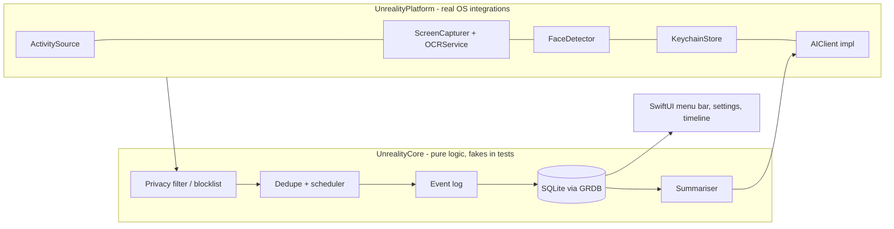

# Architecture

Stack: native Swift ([ADR 0001](decisions/0001-technology-stack.md)). Status: scaffold only (SwiftPM packages and an empty menu-bar app shell); no features yet.

## Modules
- **UnrealityCore** — domain types, scheduler, dedupe, privacy filtering, retention, summarisation orchestration, storage schema. No OS imports.
- **UnrealityPlatform** — real implementations of every protocol.
- **App** — SwiftUI/AppKit shell, generated via XcodeGen.

## Repository layout
| Path | Contents |
|---|---|
| `Package.swift` | SwiftPM manifest: `UnrealityCore`, `UnrealityPlatform` libraries and their test targets |
| `Sources/UnrealityCore` | Pure logic. Allow-listed imports only (Foundation, Dispatch, Observation, Synchronization, RegexBuilder); anything else, including any OS framework, is a lint error (`core_no_os_imports` in `.swiftlint.yml`, also applied to `Tests/UnrealityCoreTests`) |
| `Sources/UnrealityPlatform` | Real OS integrations; depends on the core |
| `Tests/` | Swift Testing suites per library |
| `App/` + `project.yml` | Menu-bar app shell (`LSUIElement`, macOS 14, bundle ID `com.lemacarl.unreality`); `Unreality.xcodeproj` is generated by XcodeGen and gitignored |
| `Config/` | `Signing.xcconfig` (ad-hoc default) with an optional, gitignored `Local.xcconfig` override |

## Swift language mode
**Swift 6 language mode** for every target (`swiftLanguageModes: [.v6]` in `Package.swift`, `SWIFT_VERSION = 6.0` in `project.yml`), built with the Swift 6.2 toolchain (Xcode 26). Reasons: complete strict concurrency checking from the first line of code is far cheaper than migrating later, and the capture/OCR/presence pipeline is concurrent by nature, so data races should be compile errors. Tools version is 6.0 so slightly older Swift 6 toolchains (e.g. on CI runners) still resolve the package. Tests use Swift Testing.

Considered and not enabled: Swift 6.2's default MainActor isolation (`SWIFT_DEFAULT_ACTOR_ISOLATION = MainActor` / `.defaultIsolation(MainActor.self)`) and the "approachable concurrency" upcoming features. Most of the code is background capture, OCR and storage, so implicit MainActor isolation would push work onto the UI thread by default, and the packages and the app shell should share one set of rules. UI types are annotated `@MainActor` explicitly. Revisit for the App target if the annotation noise grows.

Revisit the mode if a required Apple framework is unusable under strict concurrency; in UnrealityPlatform prefer a local `@preconcurrency import` over dropping the mode (in UnrealityCore the import allow-list still applies).

## Data flow
Platform sources emit samples → privacy filter drops excluded apps/sites (before capture or OCR where possible, always before storage) → dedupe skips unchanged screens → events/OCR text/presence booleans written to SQLite → retention job deletes raw captures after the window → summariser sends text only to the Claude API.

## Storage schema, threading model
To be filled in by the M2 storage issue. Threading: capture on background actors, DB access serialised via GRDB, UI on the main actor.
