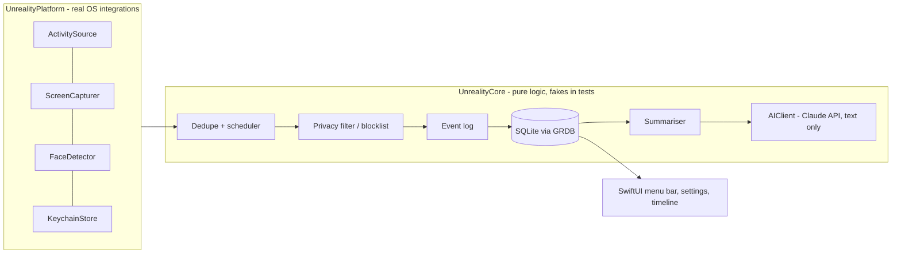

# Architecture

Stack: native Swift ([ADR 0001](decisions/0001-technology-stack.md)). Status: design only; no code yet.

## Modules
- **UnrealityCore** — domain types, scheduler, dedupe, privacy filtering, retention, summarisation orchestration, storage schema. No OS imports.
- **UnrealityPlatform** — real implementations of every protocol.
- **App** — SwiftUI/AppKit shell, generated via XcodeGen.

## Data flow
Platform sources emit samples → privacy filter drops excluded apps/sites before anything is stored → dedupe skips unchanged screens → events/OCR text/presence booleans written to SQLite → retention job deletes raw captures after the window → summariser sends text only to the Claude API.

## Storage schema, threading model
To be filled in by the M2 storage issue. Threading: capture on background actors, DB access serialised via GRDB, UI on the main actor.
